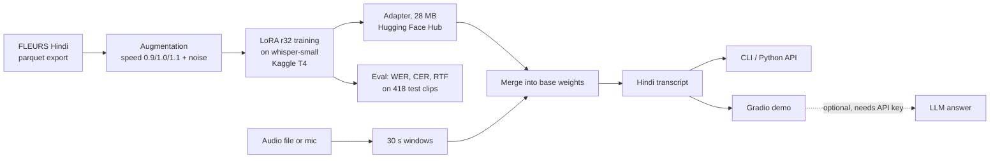

# hindi-voice-asr

[](pyproject.toml)
[](https://pytorch.org)
[](https://huggingface.co/docs/transformers)
[](https://github.com/huggingface/peft)
[](app/demo.py)
[](https://huggingface.co/Dratinia/whisper-small-hindi-lora)
[](LICENSE)

Hindi / Hinglish speech-to-text for developers who need a small, fast Hindi transcriber: **`openai/whisper-small` fine-tuned with LoRA on Google FLEURS Hindi**, evaluated against the zero-shot base model (and whisper-medium), with a Python API, a CLI and a speak-a-question demo.

- a Python API, `transcribe("clip.wav") -> "हिंदी टेक्स्ट"`, with the adapter merged into the base model so decoding costs exactly what the base model costs;
- a CLI (`hindi-asr clip.wav`);
- a published LoRA adapter on the Hugging Face Hub: **[Dratinia/whisper-small-hindi-lora](https://huggingface.co/Dratinia/whisper-small-hindi-lora)** (28 MB);
- a small Gradio demo: record or upload audio, read the transcript, and optionally send it to an LLM for an answer. It works without any API key and then only transcribes.

## Results at a glance

FLEURS Hindi test set, 418 utterances, one Kaggle T4. Source: [RESULTS.md](RESULTS.md) and `results/results.json`.

<!-- All numbers below are copied from RESULTS.md (table "FLEURS Hindi test" and the loop-free and ablation sections). -->

| | WER % | CER % |
|---|---:|---:|
| whisper-small, zero-shot | 79.19 | 49.44 |
| whisper-medium, zero-shot (3x larger) | 42.95 | 21.40 |
| **whisper-small + LoRA r32 (this repo)** | **24.53** | **10.11** |

- Fine-tuning cuts WER from 79.19 % to 24.53 % (-69 % relative) and beats the larger zero-shot whisper-medium.
- Part of that gap is the base model looping: on the 380 clips where no model loops, WER is 55.91 % zero-shot vs 23.42 % fine-tuned.
- Single-stream real-time factor is 0.130 for the fine-tuned model vs 0.173 for the base (T4, fp16). The adapter is merged into the base weights, so it adds no decoding cost.
- One seed per configuration, and FLEURS is clean read speech; see [Limitations and honest notes](#limitations-and-honest-notes).

## How it works



Training and evaluation run in one Kaggle script kernel; inference downloads the adapter from the Hub, merges it into `whisper-small` and decodes greedily. Details are in [Implementation details](#implementation-details).

## Quick start

```bash
python -m venv .venv && . .venv/bin/activate
pip install -e ".[demo,llm]"          # torch, transformers, peft, jiwer, gradio, ...
hindi-asr question.wav                 # fine-tuned model; use your own Hindi clip (wav, flac or mp3)
hindi-asr --base question.wav          # zero-shot whisper-small, for comparison
python app/demo.py                     # http://127.0.0.1:7860
```

- **No GPU needed to run it.** It works on CPU, only slower; I checked the CLI, the base-model comparison, the demo server and `pytest` on a CPU-only machine. The first run downloads whisper-small and the 28 MB adapter from the Hugging Face Hub (no token needed).
- **A GPU is needed only to retrain** (the Kaggle T4 kernel in [Reproduce](#reproduce)), which also needs a Kaggle account and API token.
- **The LLM answer in the demo is optional** and needs an `ANTHROPIC_API_KEY` or `OPENAI_API_KEY`; without one the demo only transcribes. The LLM path was not part of the evaluation.

## Limitations and honest notes

- **Not deployed.** This is a local demo and a published adapter; there is no hosted service, and no real users or production use are claimed.
- **Read speech only.** FLEURS is read Wikipedia-style sentences, so conversational, noisy, telephone or strongly code-switched audio will be worse. FLEURS writes English loanwords in Devanagari, so the model learns to do the same (see [MODEL_CARD.md](MODEL_CARD.md)).
- **One seed, no confidence intervals.** The ablation differences (1-2.5 WER) are within what seed variance can produce. The test set is 1.3 h, and it is held out: it was not used for training or for picking the epoch (200 validation utterances were).
- **Headline gain includes loops.** Zero-shot whisper-small loops on 35 of 418 clips; the like-for-like loop-free comparison is in [Results at a glance](#results-at-a-glance).
- **Latency is not a serving benchmark.** RTF is from fp16 Hugging Face `generate` on a T4, not an optimised stack.
- **No CI.** There is no GitHub Actions workflow; only the unit tests in `tests/` (`pytest`).

## What I learned / design decisions

- **Own text normaliser.** Whisper's `BasicTextNormalizer` deletes Devanagari matras and viramas, which under-counts errors, so scoring uses `hindi_asr.text.normalize` (NFC, punctuation and danda removed, Latin lowercased).
- **Check that a headline number is not an artefact.** Much of the base model's 79 % WER comes from repetition loops, so I counted them and re-scored every model on the loop-free subset as well.
- **LoRA on all attention projections, merged for inference.** Adapting `q/k/v/out` in encoder and decoder (self and cross) trains 7.08 M parameters (2.8 %); merging the adapter afterwards means decoding costs the same as the base model.
- **Small ablations, honestly read.** Rank 32 vs 8 (24.53 vs 26.98 WER) and augmentation on vs off (24.53 vs 25.67), each with one seed, reported as indicative rather than significant.
- **Reproducibility.** One Kaggle script kernel with fixed seeds trains and evaluates every model in the tables, with the exact code bundled from this repo; raw predictions and training logs are committed in `results/`.

## Detailed results (FLEURS Hindi test, 418 utterances, Kaggle T4)

WER and CER are in [Results at a glance](#results-at-a-glance); ablations are under [What I learned](#what-i-learned--design-decisions).

| Model | Single-stream RTF | Runaway outputs |
|---|---:|---:|
| whisper-small, zero-shot | 0.173 | 35 |
| whisper-medium, zero-shot (3× larger) | 0.241 | 6 |
| **whisper-small + LoRA r32 (this repo)** | **0.130** | 1 |

Full tables, run IDs, versions and qualitative examples, including the code-switched (Latin-script) subset, are in **[RESULTS.md](RESULTS.md)**. Data, training details and limitations are in **[MODEL_CARD.md](MODEL_CARD.md)**.

## Usage details

Install and CLI commands are in [Quick start](#quick-start). The adapter is fetched from the Hub (`Dratinia/whisper-small-hindi-lora`) unless `artifacts/adapter/` exists.

```python
from hindi_asr.inference import transcribe
print(transcribe("question.wav"))                 # whisper-small + Hindi LoRA
print(transcribe("question.wav", adapter=None))   # zero-shot base
```

It runs on CPU (slowly) or on any CUDA GPU in fp16. Audio of any length is split into 30 s windows.

### LLM answers (optional)

The demo and `hindi-asr --ask` pass the transcript to a pluggable client (`src/hindi_asr/llm.py`):

| Env var | Effect |
|---|---|
| `ANTHROPIC_API_KEY` | use Claude (default model `claude-haiku-4-5-20251001`) |
| `OPENAI_API_KEY` (+ optional `OPENAI_BASE_URL`) | use an OpenAI-compatible endpoint, including a local vLLM or Ollama server |
| `HINDI_ASR_LLM` | force `anthropic`, `openai` or `none` |
| `HINDI_ASR_LLM_MODEL` | override the model name |

Keys are read from the environment only and are never written anywhere.

### Use the published adapter

The adapter is published at [huggingface.co/Dratinia/whisper-small-hindi-lora](https://huggingface.co/Dratinia/whisper-small-hindi-lora). `transcribe()`, the CLI and the demo use it by default, and also accept a Hub id via `--adapter` or `HINDI_ASR_ADAPTER`. Without this package, plain `transformers` + `peft` is enough:

```python
import torch
from peft import PeftModel
from transformers import WhisperForConditionalGeneration, WhisperProcessor

processor = WhisperProcessor.from_pretrained("openai/whisper-small", language="hindi", task="transcribe")
model = WhisperForConditionalGeneration.from_pretrained("openai/whisper-small")
model = PeftModel.from_pretrained(model, "Dratinia/whisper-small-hindi-lora").merge_and_unload().eval()

# audio: 16 kHz mono float32 numpy array, up to 30 s
features = processor.feature_extractor(audio, sampling_rate=16_000, return_tensors="pt").input_features
with torch.inference_mode():
    ids = model.generate(input_features=features, language="hi", task="transcribe", max_new_tokens=440)
print(processor.batch_decode(ids, skip_special_tokens=True)[0])
```

### Get the adapter

The adapter is a Kaggle kernel output and is not stored in git. To use a local copy, for example offline, copy it into `artifacts/adapter/`, which takes precedence over the Hub:

```bash
KAGGLE_API_TOKEN=... kaggle kernels output abhigyan1881/hva-whisper-lora -p kaggle/output/full
mkdir -p artifacts && cp -r kaggle/output/full/adapters/lora-r32-aug artifacts/adapter
```

Alternatively, set `HINDI_ASR_ADAPTER` to an adapter directory or a Hub id.

## Implementation details

| Piece | Where | Notes |
|---|---|---|
| Data | `src/hindi_asr/data.py` | FLEURS `hi_in` from the ungated parquet export (no loading script); 16 kHz mono |
| Augmentation | `data.py: Augment` | 3-way speed perturbation (0.9/1.0/1.1, Kaldi style) plus white noise at 10–30 dB SNR with p=0.3; seeded per (epoch, item) |
| Text normalisation | `src/hindi_asr/text.py` | NFC, punctuation/symbols/danda removed, Latin lowercased. **Whisper's `BasicTextNormalizer` is not used**, because it deletes Devanagari matras and viramas (Unicode combining marks) and so under-counts errors |
| Model | `src/hindi_asr/model.py` | LoRA on `q_proj,k_proj,v_proj,out_proj` of every encoder/decoder attention block (self and cross), alpha = 2·rank, dropout 0.05 |
| Training | `src/hindi_asr/train.py` | plain PyTorch loop, fp16 autocast + GradScaler, AdamW lr 1e-3, 10 % warmup then linear decay, effective batch 16 (8×2 accumulation), 5 epochs, best epoch picked on 200 validation utterances |
| Evaluation | `kaggle/pipeline.py` | greedy decoding, `language=hi, task=transcribe`, full FLEURS test split; corpus WER/CER; single-stream RTF on 60 test clips; batched throughput |
| Kaggle bundling | `kaggle/build_kernel.py` | packs `src/` + the pipeline into one script kernel (`kaggle/kernels/full/`) |

## Reproduce

```bash
python kaggle/build_kernel.py --mode smoke   # 3-minute end-to-end check on a T4
python kaggle/build_kernel.py --mode full    # baselines + 3 LoRA runs + whisper-medium (about 1.8 h on a T4)
KAGGLE_API_TOKEN="$(cat ~/.kaggle-abhigyan1881/access_token)" kaggle kernels push -p kaggle/kernels/full
KAGGLE_API_TOKEN=... kaggle kernels output abhigyan1881/hva-whisper-lora -p kaggle/output/full
python kaggle/report.py kaggle/output/full    # Markdown tables for RESULTS.md
pytest                                         # normaliser / metric / augmentation unit tests
```

## Possible follow-ups

- A voice front-end for the `guardrailed-sql-analyst` project: ask a data question aloud, then transcribe → SQL agent.
- Add Common Voice / IndicVoices / Shrutilipi data for conversational coverage, then try whisper-medium + LoRA or distil/turbo variants for latency.
- Streaming (chunked) decoding and CTranslate2 / faster-whisper export for CPU serving.

## Licence

Code: MIT. Base model `openai/whisper-small`: Apache-2.0. FLEURS data: CC-BY-4.0. The adapter is a derivative of both (see the model card).
